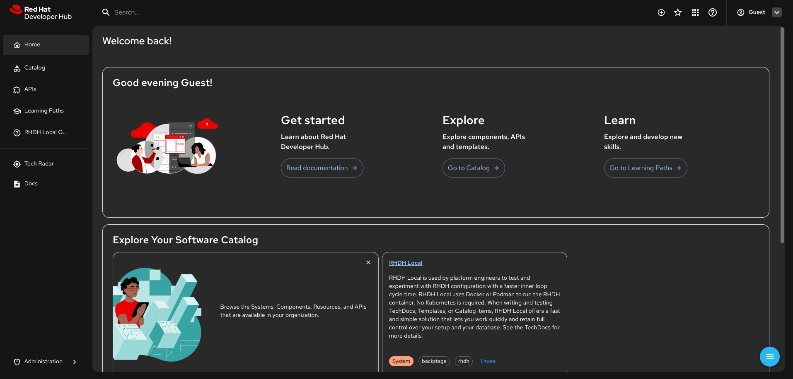

# RHDH Local

The fastest and simplest way for platform engineers to test Red Hat Developer Hub (RHDH) features locally.

RHDH Local lets you quickly test software catalogs, TechDocs, plugins, templates, and configurations without needing a cluster. Perfect for individual development and testing on your laptop, desktop, or homelab.

> [!CAUTION]
>
> - RHDH Local is **NOT a substitute for Red Hat Developer Hub**.
> - It is for development and testing only, **not for production use**.
> - It is designed for individual developers try out various RHDH features, not for teams as there is no out-of-the-box RBAC support.
> - There is no official, commercial support for RHDH Local. Use RHDH Local at your own risk.

## Quick Start

1. **Prerequisites**: [Podman](https://podman.io/docs/installation) v5.4.1+ (recommended) or [Docker](https://docs.docker.com/engine/) v28.1.0+ with Compose support

2. **Clone and start**:

   ```sh
   git clone https://github.com/redhat-developer/rhdh-local.git && cd rhdh-local
   podman compose up -d  # or: docker compose up -d
   ```

   > **Developer Hub Intelligent Assistant** is included by default without OKP-backed product documentation. To configure an LLM provider, opt in to OKP, or disable Intelligent Assistant, see the [Developer Hub Intelligent Assistant Guide](./docs/intelligent-assistant/working-with-intelligent-assistant.md).

3. **Access**: Open [http://localhost:7007](http://localhost:7007) and log in as 'Guest'



## Built-in Documentation

RHDH Local includes comprehensive technical TechDocs covering everything you need to know about it. Once running, access the documentation directly in the application for detailed guides on:

- **Getting Started**: Understanding RHDH Local's purpose and capabilities
- **Loading Content**: Adding catalogs, templates, and TechDocs
- **Dynamic Plugins**: Installing, configuring, and developing plugins
- **GitHub Integration**: Setting up authentication and content fetching
- **Local Development**: Working with plugins and configurations
- **Operations**: Running, restarting, and troubleshooting

The built-in documentation provides step-by-step technical instructions with examples.

## Quick Commands

> **Note**: Replace `podman` with `docker` if using Docker.

### After Plugin changes

After modifying the plugins configuration, for example after configuring plugins using the Extensions in the RHDH UI:

```sh
# Reinstall plugins and restart RHDH
podman compose run install-dynamic-plugins  # or: docker compose run install-dynamic-plugins
podman compose stop rhdh                    # or: docker compose stop rhdh
podman compose start rhdh                   # or: docker compose start rhdh
```

### Quick restart (No Plugin changes)

For configuration-only changes:

```sh
# Just restart RHDH (if plugins haven't changed)
podman compose stop rhdh   # or: docker compose stop rhdh
podman compose start rhdh  # or: docker compose start rhdh
```

### Clean up

```sh
podman compose down --volumes  # or: docker compose down --volumes
```

## Additional Configuration Guides

If you would like to change your RHDH-Local setup, or add additional features or plugins, please check out the guides below.

1. [Plugins Guide](./docs/rhdh-local-guide/plugins-guide.md) - how to include your own plugins
2. [Container Image Guide](docs/rhdh-local-guide/container-image-guide.md) - how to switch to a more bleeding edge, or commercially supported version of RHDH
3. [Simulated Proxy Setup](docs/rhdh-local-guide/corporate-proxy-setup-sim.md) - testing in a simulated proxy environment
4. [PostgreSQL Guide](docs/rhdh-local-guide/postgresql-guide.md) - using PostgreSQL instead of an in-memory database
5. [Orchestrator Workflow Guide](./orchestrator/README.md) - using Orchestrator with RHDH to develop workflows.
6. [Developer Hub Intelligent Assistant Guide](./docs/intelligent-assistant/working-with-intelligent-assistant.md) - configuring an LLM provider for the built-in Developer Hub Intelligent Assistant.
7. [Developer Hub Intelligent Assistant Maintainer Guide](./docs/intelligent-assistant/maintaining-intelligent-assistant.md) - maintaining and syncing Lightspeed Core configuration files.

## Contributing and reporting issues

To report issues against this repository, please use [JIRA](https://issues.redhat.com/browse/RHIDP) with Component: **RHDH Local**

To browse the existing issues, you can use this [Query](https://issues.redhat.com/issues/?filter=-4&jql=project%20%3D%20%22Red%20Hat%20Internal%20Developer%20Platform%22%20%20AND%20component%20%3D%20%22RHDH%20Local%22%20AND%20resolution%20%3D%20Unresolved%20ORDER%20BY%20status%2C%20priority%2C%20updated%20%20%20%20DESC).

Contributions are welcome!


## Breaking changes and known issues

### Upgrading to RHDH 2.1

Check out the [RHDH 2.1 Release Notes](https://docs.redhat.com/en/documentation/red_hat_developer_hub/2.1/html-single/red_hat_developer_hub_release_notes/index) for a complete list of new features and enhancements, breaking changes, and known issues.

If you [switch your `RHDH_IMAGE`](docs/rhdh-local-guide/container-image-guide.md#changing-the-container-image) to 2.1+, be aware of the following potential breaking changes:

1. **Plugin wrappers removed from the RHDH image**

   All plugin wrappers have been removed from the RHDH container image ([RHDHPLAN-934](https://issues.redhat.com/browse/RHDHPLAN-934)). RHDH GA and TP supported plugins are no longer built into the image and are instead fetched as OCI artifacts from a container registry at runtime. This means `./dynamic-plugins/dist/` paths no longer work. Use `ref://plugin-name` for plugins included in the default plugin catalog index image, or `oci://` with the full package reference otherwise.

2. **Use `ref://` or `oci://` syntax for plugin references in `dynamic-plugins.override.yaml`**

   Use `ref://plugin-name` to resolve the plugin package from the catalog index listed under `includes`, or use `oci://` with a full package reference for plugins not in the catalog index.

   For example, instead of:
   ```yaml
   - package: ./dynamic-plugins/dist/backstage-community-plugin-tech-radar
   ```

   Use:
   ```yaml
   - package: ref://backstage-community-plugin-tech-radar
   ```

   The `oci://` syntax with `{{inherit}}` is still supported and required when you need to specify a `!plugin-path` suffix. See [Plugin references](https://github.com/redhat-developer/rhdh/blob/release-2.1/docs/dynamic-plugins/installing-plugins.md#plugin-references) for more details.

3. **Use `enabled` instead of `disabled`**

   The legacy per-plugin `disabled` key in the dynamic plugins configuration file remains supported but is deprecated. Use `enabled` for new or updated entries. For example, replace `disabled: false` with `enabled: true`.

4. **Enable the guest auth provider in your override file**

   RHDH 2+ no longer bundles auth provider plugins statically. If you are overriding the plugins configuration and need Guest authentication, add:

   ```yaml
   - package: ref://backstage-plugin-auth-backend-module-guest-provider
     enabled: true
   ```

5. **Developer Lightspeed renamed to Developer Hub Intelligent Assistant**

   The Lightspeed plugins have been renamed to Developer Hub Intelligent Assistant. This feature remains enabled by default, so no action is required unless you reference Lightspeed plugins in your `dynamic-plugins.override.yaml`. If so, update to the new names:

   ```yaml
   - package: ref://red-hat-developer-hub-backstage-plugin-intelligent-assistant
   - package: ref://red-hat-developer-hub-backstage-plugin-intelligent-assistant-backend
   ```

   The LLM provider configuration has also changed. See the [Developer Hub Intelligent Assistant Guide](./docs/intelligent-assistant/working-with-intelligent-assistant.md) for the updated setup.

6. **Update Orchestrator plugin references**

   If you use the [Orchestrator](./orchestrator/README.md), update the plugin references in your configuration from `oci://` URLs to `ref://` syntax:

   ```yaml
   - package: ref://red-hat-developer-hub-backstage-plugin-orchestrator
   - package: ref://red-hat-developer-hub-backstage-plugin-orchestrator-backend
   - package: ref://red-hat-developer-hub-backstage-plugin-scaffolder-backend-module-orchestrator
   - package: ref://red-hat-developer-hub-backstage-plugin-orchestrator-form-widgets
   ```

   See the [Orchestrator Workflow Guide](./orchestrator/README.md) for the full updated configuration and [Plugin references](https://github.com/redhat-developer/rhdh/blob/release-2.1/docs/dynamic-plugins/installing-plugins.md#plugin-references) for more details on the `ref://` syntax.

7. **Use the Compose overlay for PostgreSQL**

   PostgreSQL is no longer configured by editing `compose.yaml` or `app-config.yaml` directly. Instead, use the separate [`compose-with-db.yaml`](compose-with-db.yaml) overlay:

   ```sh
   podman compose -f compose.yaml -f compose-with-db.yaml up -d
   ```

   See the [PostgreSQL Guide](./docs/rhdh-local-guide/postgresql-guide.md) for details on optional overrides and major version upgrades.

For dynamic plugin configuration, also see [configs/dynamic-plugins/dynamic-plugins.override.example.yaml](configs/dynamic-plugins/dynamic-plugins.override.example.yaml) for a full example.

### Upgrading to RHDH 1.9

More details in the [RHDH 1.9 Release Notes](https://docs.redhat.com/en/documentation/red_hat_developer_hub/1.9/html/red_hat_developer_hub_release_notes/index).

If you switch your `RHDH_IMAGE` to 1.9+ (default value in this branch), you may need to:

1. **Update your `dynamic-plugins.override.yaml`**

Some plugins are no longer bundled in the RHDH image, but have been moved to OCI references.

See [Migration Steps](https://docs.redhat.com/en/documentation/red_hat_developer_hub/1.9/html/dynamic_plugins_reference/ref-community-plugins-migration_title-plugins-rhdh-about#migration-steps) for more information.

Also see [configs/dynamic-plugins/dynamic-plugins.override.example.yaml](configs/dynamic-plugins/dynamic-plugins.override.example.yaml) for an example.

2. **Update any scaffolder modules**

Ensure they are built for the Backstage version used in RHDH 1.9. Otherwise the backend may fail to start (e.g. `TypeError: Cannot read properties of undefined (reading 'id')`). See [RHDHBUGS-2497](https://issues.redhat.com/browse/RHDHBUGS-2497) as a known issue.


## License

```txt
Copyright Red Hat

Licensed under the Apache License, Version 2.0 (the "License");
you may not use this file except in compliance with the License.
You may obtain a copy of the License at

   http://www.apache.org/licenses/LICENSE-2.0

Unless required by applicable law or agreed to in writing, software
distributed under the License is distributed on an "AS IS" BASIS,
WITHOUT WARRANTIES OR CONDITIONS OF ANY KIND, either express or implied.
See the License for the specific language governing permissions and
limitations under the License.
```
